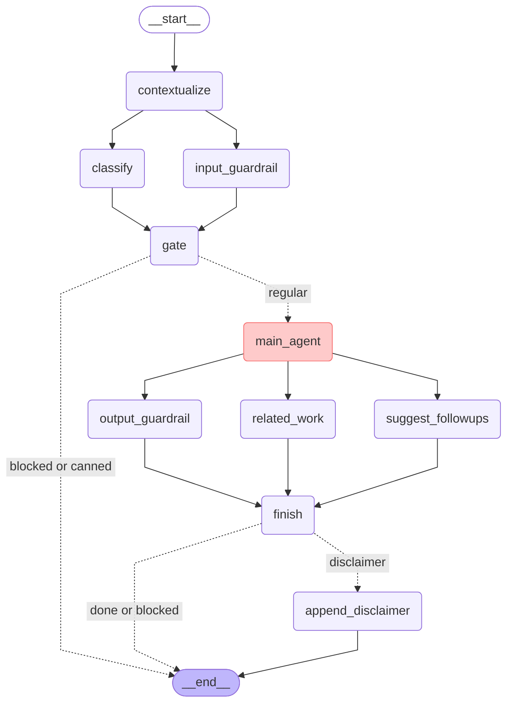
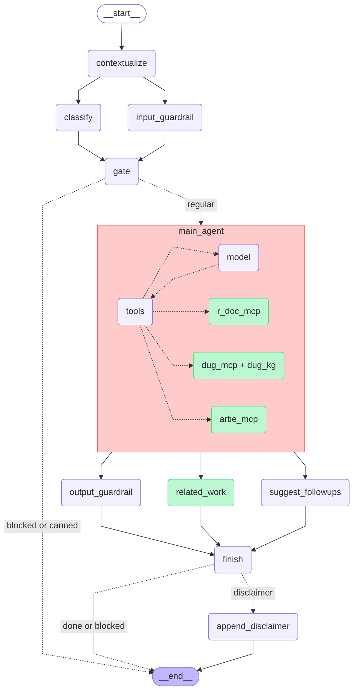
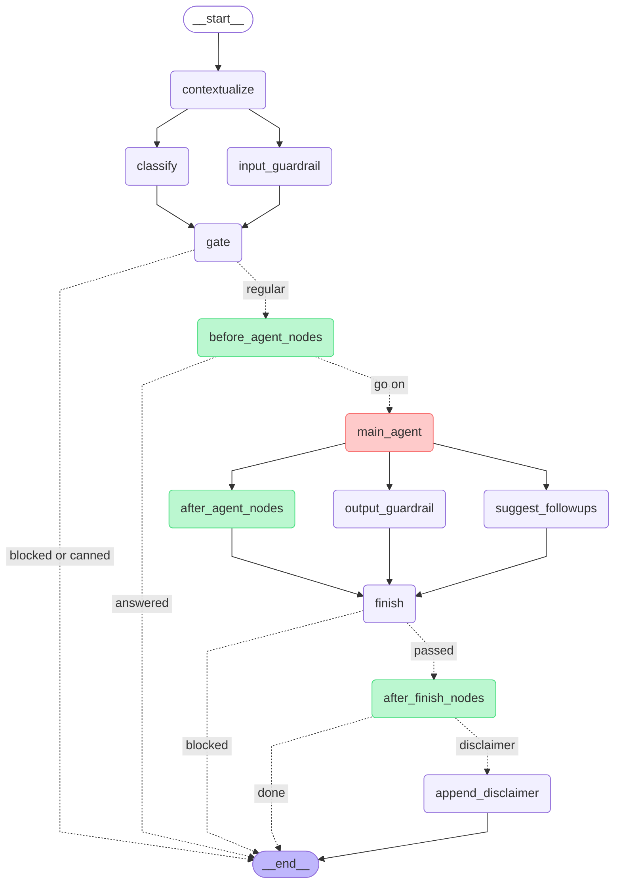
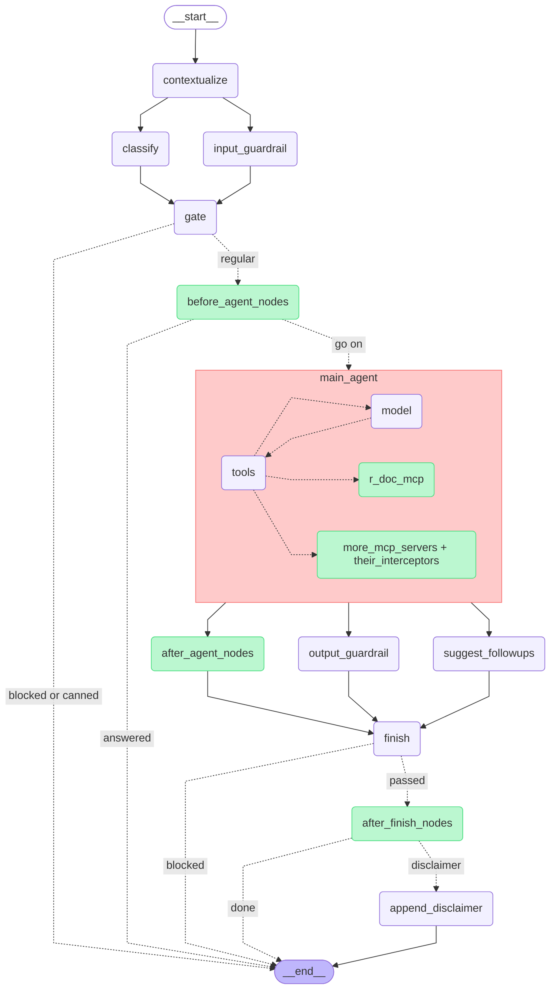

# r-assist workflow

The mermaid source of the workflow pictures. Written by `docs/draw_workflow.py`: edit the code
and rerun it, not this file.

## The BDC config (workflow_bdc.png)

## The BDC config, inside main_agent too (workflow_bdc_detailed.png)

## General purpose, every slot with a placeholder (workflow_general.png)

## General purpose, every slot with a placeholder, inside main_agent too (workflow_general_detailed.png)

